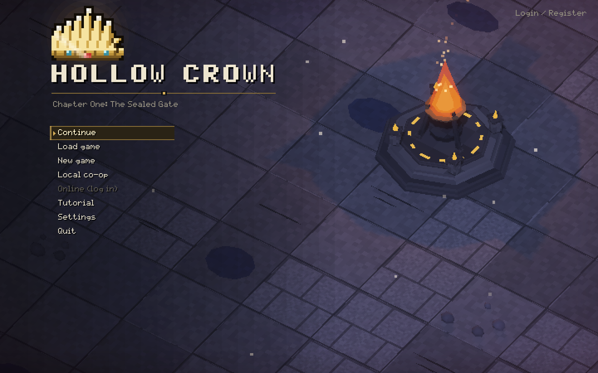
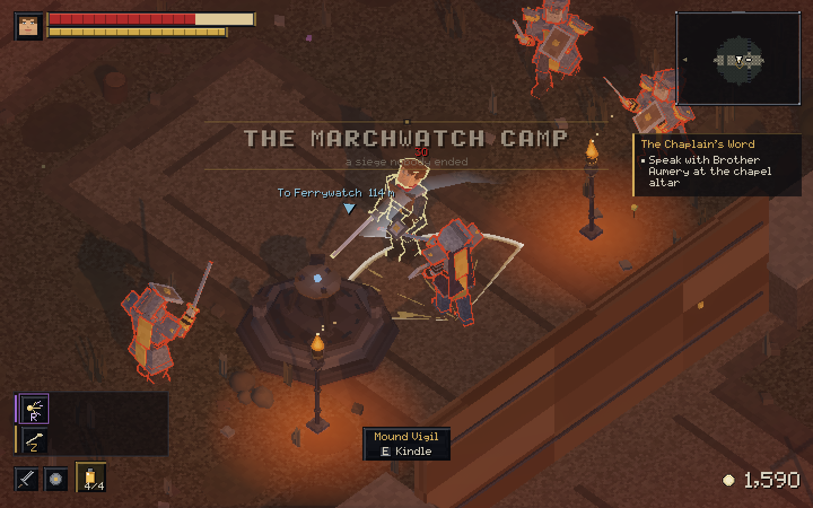
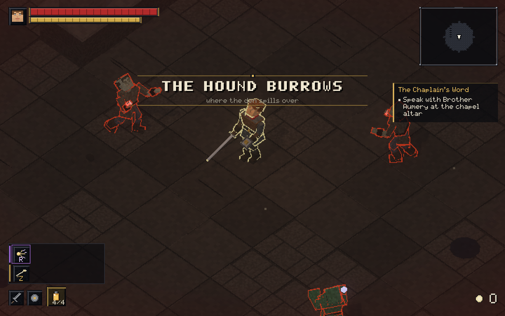

# Hollow Crown

**An isometric Soulslike RPG.** Chapter One: *The Sealed Gate* is playable from the title screen to the Crownhall.

## About the game

Hollow Crown is built around deliberate, stamina-based combat and a story-driven journey through a ruined kingdom. Fight with melee and ranged weapons, learn to dodge, guard, parry and riposte, then shape your character through weapon skills and six ability trees.

Play solo, in local co-op, or online. Online play requires v0.2.16 or newer. Keyboard and mouse and Xbox and PlayStation controllers are supported.

## Screenshots

  
  

Screenshots are from the v0.2.15 game build.

## Download

The latest public build is **v0.2.16**. Download the installer for your platform:

- [macOS](https://github.com/fhwifmw/hollow-crown-releases/releases/download/v0.2.16/HollowCrown-0.2.16-macOS.zip)
- [Windows](https://github.com/fhwifmw/hollow-crown-releases/releases/download/v0.2.16/HollowCrown-0.2.16-Windows.zip)
- [Release notes, checksums, and all downloads](https://github.com/fhwifmw/hollow-crown-releases/releases/tag/v0.2.16)

## Official updates

This is the official Hollow Crown home for news and future release notes. Follow [Releases](https://github.com/fhwifmw/hollow-crown/releases) for updates. The current v0.2.16 game downloads are in the [Hollow Crown Releases archive](https://github.com/fhwifmw/hollow-crown-releases/releases).

## License

Hollow Crown, including its original code, story, characters, artwork, and game content, is proprietary. All rights are reserved. This repository does not grant permission to copy, modify, redistribute, or reuse those materials. Third-party components retain their own licenses. See [LICENSE](LICENSE).

## Built with

[Godot 4.7 .NET](https://godotengine.org/).
