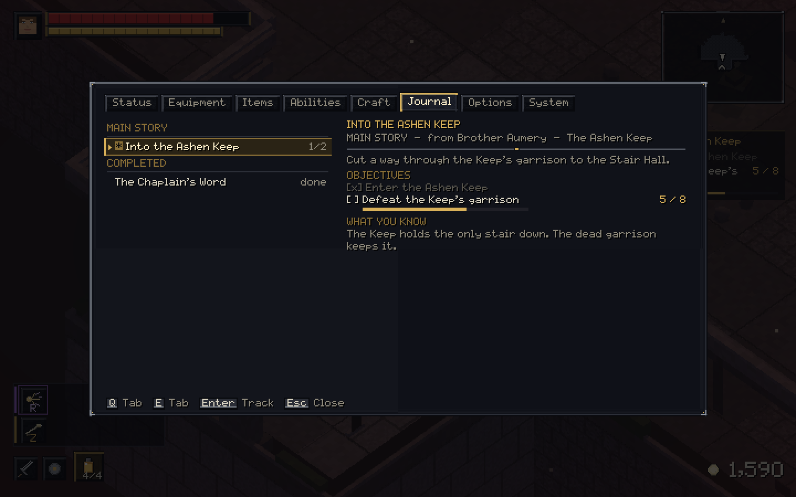
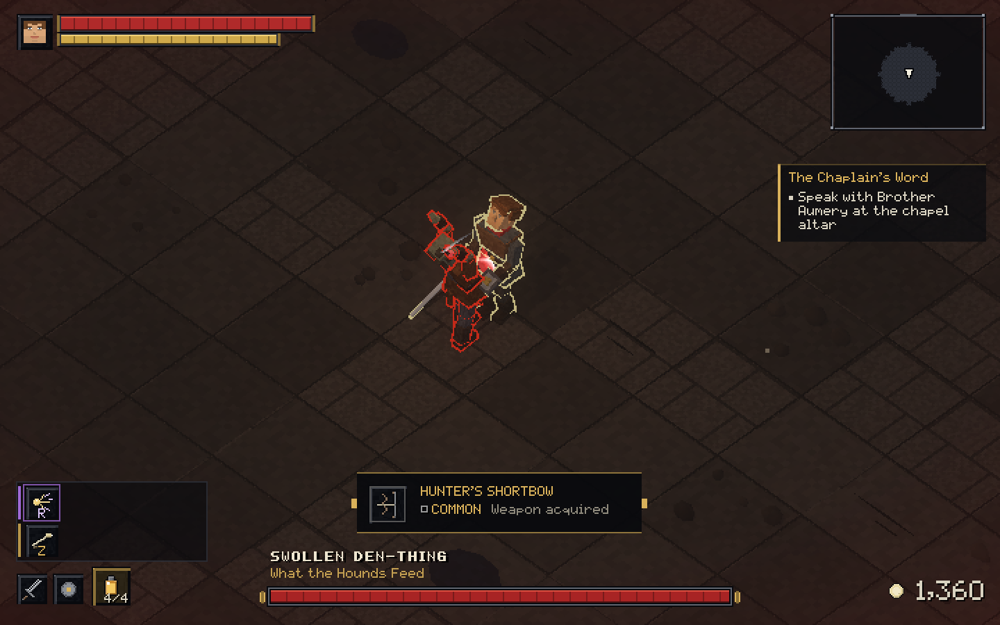
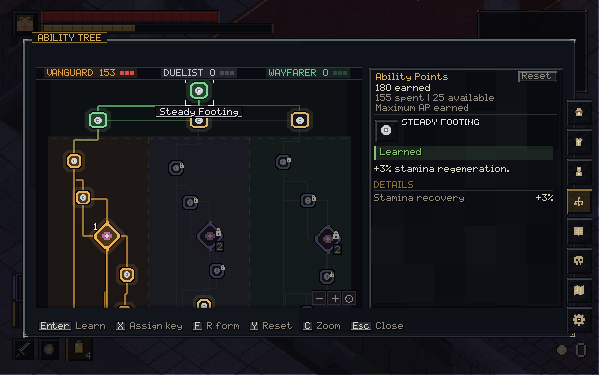
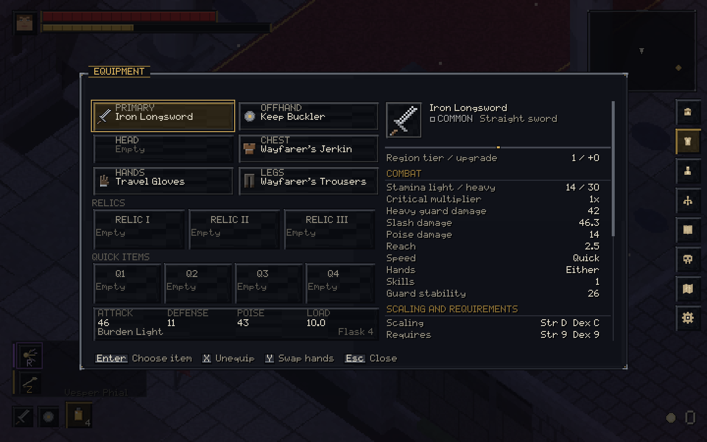

# Hollow Crown Demo

**A pre-release demo of an isometric Soulslike RPG.** Its planned scope is Chapter One: *The Sealed Gate*, from the title screen through the Crownhall.

## What you'll play

Hollow Crown Demo is an isometric, story-driven Soulslike set in a kingdom in ruin. Its planned demo boundary is the end of Chapter One: *The Sealed Gate*, at the Crownhall. Explore hostile camps and underground passages, follow the main story and side quests, and prepare for fights where stamina and timing matter.

## Explore and follow the story

Travel through places like the Marchwatch Camp, uncover routes and points of rest, and keep track of what comes next in the in-game journal. Main-story and side-quest objectives are recorded alongside the clues your character has uncovered.

  
  

## Combat and dungeons

Fight with melee and ranged weapons. Dodge, guard, parry, and riposte around enemy attacks, then use weapon skills to press an opening. Dungeon runs take you through linked rooms with enemies and loot before a boss encounter.

  
  

## Build your character

Earn Ability Points as you progress and shape your character across six 442-node ability trees. Choose specializations, tune your equipment, and bring weapons, armor, relics, quick items, and weapon skills suited to your approach.

  
  

## Play solo or with friends

Play solo, in local co-op, or online. Keyboard and mouse and Xbox/PlayStation controllers are supported. Online play requires v0.2.16 or newer.

The title, world, dungeon, and journal captures are from v0.2.15. The ability-tree and equipment screens show the updated v0.2.16 progression UI.

## Current downloads

The currently linked packages are **v0.2.16**:

- [macOS](https://github.com/fhwifmw/hollow-crown-releases/releases/download/v0.2.16/HollowCrown-0.2.16-macOS.zip)
- [Windows](https://github.com/fhwifmw/hollow-crown-releases/releases/download/v0.2.16/HollowCrown-0.2.16-Windows.zip)
- [Package checksums](https://github.com/fhwifmw/hollow-crown-releases/releases/download/v0.2.16/SHA256SUMS.txt)

## VirusTotal scans

Results are tied to the exact SHA-256 values below. The macOS app report is for `Hollow Crown.app.zip`; the linked v0.2.16 macOS download has a different hash and no public VirusTotal report. The Windows report matches the linked v0.2.16 Windows download. Analysis times are from 17 October 2026.

| Package | VirusTotal result | SHA-256 |
| --- | --- | --- |
| macOS app ZIP (`Hollow Crown.app.zip`) | [0/65 vendors flagged](https://www.virustotal.com/gui/file/8a5e517cc559ec872ebbe1a264a89aa1486c14faa90d759eb6bac6da55be6efe) · 10:17 GST | `8a5e517cc559ec872ebbe1a264a89aa1486c14faa90d759eb6bac6da55be6efe` |
| macOS download ZIP (`HollowCrown-0.2.16-macOS.zip`) | No public report found | `a795656e5d35d28a07dfb66924e692ce738736a17b37dde423d004054b248a6b` |
| Windows download ZIP (`HollowCrown-0.2.16-Windows.zip`) | [1/66 flagged: Bkav Pro (`W32.Malware.75404483`)](https://www.virustotal.com/gui/file/6523d4d6746fe3310f31bcf091798c9d7d448bd8792b2af847b09a6ac47246f2) · 10:29 GST | `6523d4d6746fe3310f31bcf091798c9d7d448bd8792b2af847b09a6ac47246f2` |

## Future updates

This repository documents the Hollow Crown Demo pre-release. Future updates will be published on itch.io.

Questions or bug reports? [Open an issue](https://github.com/fhwifmw/hollow-crown-demo/issues/new).

## License

Hollow Crown, including its original code, story, characters, artwork, and game content, is proprietary. All rights are reserved. This repository does not grant permission to copy, modify, redistribute, or reuse those materials. Third-party components retain their own licenses. See [LICENSE](LICENSE).

## Built with

[Godot 4.7 .NET](https://godotengine.org/).
